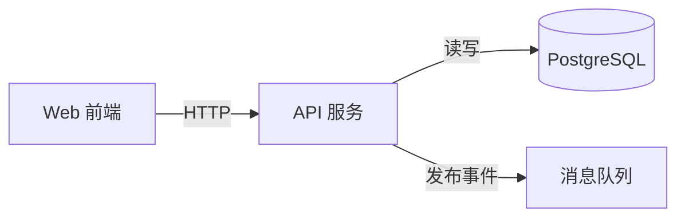

# 架构与流程

仓库挂载在 `/repo`（只读）。输出必须符合 `architecture` 结构。

## 步骤

1. **找边界**：顶层目录、workspace 包、`apps/*`、`services/*`、`cmd/*`、Docker Compose 服务、外部依赖（数据库、队列、第三方 API）。
2. **定组件**：3-12 个。每个组件写 `responsibility` 一句话，`kind` 用 `service`、`module`、`library`、`datastore`、`external`、`ui` 之一，附入口文件引用。
3. **连关系**：从 import、HTTP 客户端调用、数据库访问、消息发布订阅推断 `relations`，`label` 写动作，如“查询”“发布事件”。
4. **写流程**：挑 1-5 条最能说明系统用途的端到端流程（例如“创建订单”），每步一句话，附关键文件引用。
5. **画图**：生成 Mermaid flowchart。

## Mermaid 规则

渲染端使用 Mermaid strict 模式，以下规则必须遵守，否则图会显示失败：

- 第一行是 `flowchart TD` 或 `flowchart LR`。
- 节点 id 与 `components[].id` 完全一致，只含字母、数字、下划线，且以字母开头。
- 节点写成 `id[显示名]`，数据库可用 `id[(显示名)]`。
- 显示名与边标签里不要出现 `"`、`<`、`>`、`;`、`|`、`{`、`}`。
- 边写成 `a -->|标签| b` 或 `a --> b`。
- 不要使用 `click`、`style`、`classDef`、HTML 标签。

示例：

## 规则

- 引用路径相对仓库根。
- 不要执行仓库里的任何代码。
