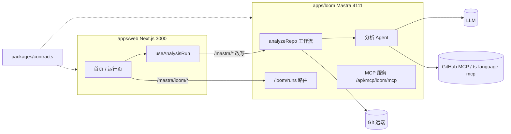
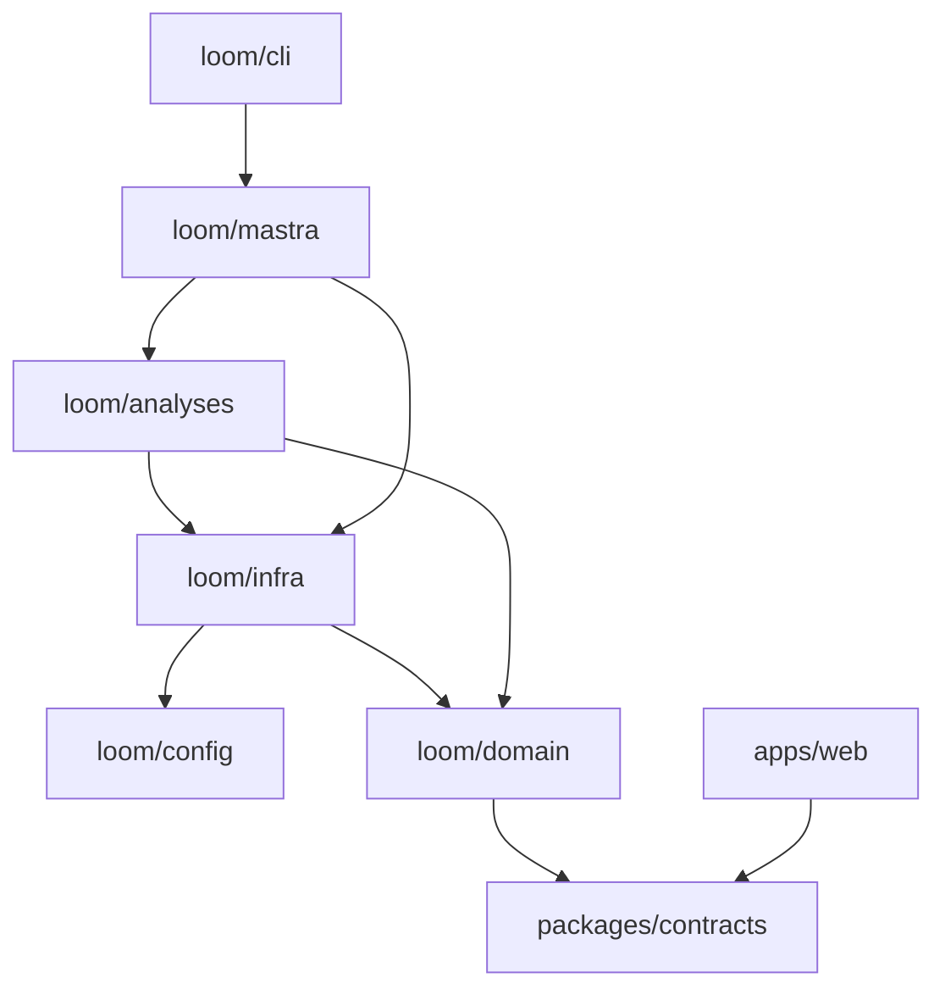
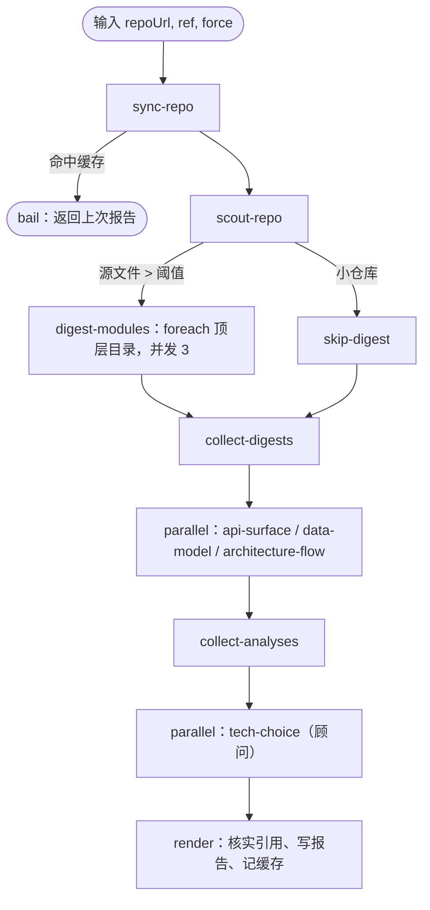

# Loom 架构

## 概览

Loom 把一个 Git 仓库变成一份结构化的“代码理解报告”：对外接口、数据模型、架构与流程图、技术选型建议。
每条结论都带仓库内的文件与行号引用，渲染前会逐条核实。

- **运行时**：Mastra 1.x（Agent、工作流、原生 `SKILL.md` 技能、Workspace 沙箱、MCP 客户端与服务端、Studio）。选型理由见 [ADR 0001](adr/0001-use-mastra.md)。
- **合同**：`packages/contracts` 的 Zod schema 是前后端唯一共享的代码，Agent 的结构化输出也用它校验。见 [ADR 0003](adr/0003-contract-first-analysis-registry.md)。
- **界面**：Next.js 16 + Tailwind CSS 4.3 + shadcn/ui；浏览器经同源 `/mastra` 访问 Mastra，模型密钥只在 Mastra 进程。

## 分层

规则由 `.dependency-cruiser.cjs` 强制，`npm run deps:check` 失败即不能合并。`domain` 不做 I/O，所以覆盖率最高、测试最快；
所有外部世界（git、文件系统、沙箱、MCP）都在 `infra`；只有 `mastra`（组合根）和 `cli` 能把它们拼起来。

## 一次分析的生命周期

1. **sync-repo**（`infra/git/repo-sync.ts`）：缓存在 `.loom/repos/<host>/<owner>/<name>/mirror`，首次
   `clone --filter=blob:none --depth 1 --no-checkout`，之后 `fetch --depth 1 origin <ref>`，每个 SHA 一个独立 worktree。
   所有 git 调用带 `core.hooksPath=/dev/null`、`GIT_TERMINAL_PROMPT=0`、不递归子模块；`GITHUB_TOKEN` 经 `http.extraHeader`
   注入（只对 github.com），不进 URL 和日志；同一仓库用文件锁串行化。
   缓存键 = 仓库 URL + SHA + 运行时技能目录哈希 + 模式与模型。非 `force` 且命中时直接 `bail`。
2. **scout-repo**（`domain/scout.ts`）：只看 `git ls-files` 清单，统计语言、顶层目录、是否有 `tsconfig.json`，判断是否大仓库。
3. **模块摘要**：大仓库按顶层目录做摘要，后续分析拿摘要作为导航，避免一次读太多文件。
4. **分析**：并行段由 `analyses/registry.ts` 中 `phase: "analyze"` 的模块生成；顾问段是 `phase: "advise"`，读取前面所有产物。
   单个分析失败只记入 `errors`，其他分析和顾问照常运行。
5. **render**：收集所有引用，用检出目录核实文件存在、行号在范围内，写 `report.json` 与 `report.md`；没有错误时才写缓存。
6. **释放**：工作流 `onFinish` 按 `runId` 关闭 Workspace、沙箱与 MCP 连接。

## Agent、技能与沙箱

每个分析模块由三部分组成：Agent（指令 + 模型 + 动态 Workspace）、步骤（调用 Agent 并用 contracts schema 做结构化输出）、
运行时技能（`apps/loom/skills/<id>/SKILL.md`）。

每次运行的 Workspace（`infra/workspace/run-workspace.ts`）：

- `/repo` 挂检出目录，`/skills` 挂运行时技能，都只读；写、删、改类工具全部关闭。
- 命令工具只在检测到 seatbelt（macOS）或 bubblewrap（Linux）时开启，断网、只读，只有本次运行的 scratch 目录可写。
- `commandHooks` 只放行 `node|python3|bash|sh skills/<name>/scripts/<file> [安全参数]`（`domain/command-policy.ts`），
  被分析仓库的代码一律不执行。
- macOS seatbelt 允许读取全盘，因此本地沙箱只适合本机单用户场景。

模型：`LOOM_MODEL`（`provider/model`）走 Mastra 模型路由；设置 `LOOM_MODEL_URL`（与可选的 `LOOM_MODEL_API_KEY`）时
改用 OpenAI 兼容接口 `<url>/chat/completions`，可接 DeepSeek、Ollama、vLLM 或公司网关。

真实模式下，Agent 调用设最大步数（`LOOM_MAX_STEPS`）；结构化输出校验失败时带错误信息重试一次，仍失败记为 `AGENT_OUTPUT_INVALID`。

## MCP

- **外部服务**（`infra/mcp`）：
  - GitHub 官方远程 MCP（`https://api.githubcopilot.com/mcp/`），只开 `repos` 只读工具集，有 `GITHUB_TOKEN` 且仓库在 github.com 时才连接。
  - `ts-language-mcp`：仓库含 `tsconfig.json` 时以 stdio 启动，只放行导航类工具（`TOOL_ALLOWLIST`）。
  - 连接失败只记录，不影响分析。
- **对外服务**（`mastra/mcp/server.ts`）：`/api/mcp/loom/mcp` 暴露 `analyzeRepo` 工作流和 `getReport` 工具，
  可以在 Cursor 等客户端里直接触发分析、读取报告。

## Web

- `/`：提交 Git 地址与可选 ref，列出最近运行（`GET /loom/runs`，运行中每 3 秒刷新）；
  “运行环境”卡片（`GET /loom/runtime`）说明当前是假模式还是真实模式、模型与接口地址、数据目录和 `.env` 位置。
- 提交时用 `run.stream()` 启动运行，读到第一个事件即断开（服务端运行不受影响）。只有 `stream` 启动的运行才有可回放的事件流，
  用 `start()` 启动的运行 `observe()` 会立刻结束。
- `/runs/[runId]`：先用 `runById` 取快照、`GET /loom/runs/:runId/logs` 取已落盘的日志，未结束则 `observe()` 回放并继续订阅事件流；
  事件流提前结束或中断（`next.config.ts` 已把代理超时 `proxyTimeout` 从默认 30 秒放宽到 30 分钟）而运行未完成时，
  每 2 秒轮询快照与日志，连续失败 5 次才报错；流中断本身不算运行失败。事件经 `runReducer` 归约，`deriveTimeline` 归并成六个阶段（含耗时与错误），
  `deriveOutcome` 给出结论（进行中、成功、部分分析失败、失败于某阶段、取消、命中缓存）；可取消。
  结束后进度与日志折叠在“运行详情”里，下面显示报告标签页（概览、API、数据结构、架构图、技术选型），可下载 Markdown 与 JSON。
- 运行日志：步骤通过 `createRunLogger`（`infra/run-log.ts`）写日志，一条日志同时进入 Mastra logger、
  步骤 `writer`（前端收到 `workflow-step-output` 事件）和 `.loom/runs/<runId>/logs.jsonl`，消息先经 `redactSecrets`。
  条目结构是 contracts 的 `runLogEntrySchema`。
- 报告 JSON 在浏览器里再用 contracts 解析一次，不符合时列出出错字段。

## 数据与配置

| 路径 | 内容 |
| --- | --- |
| `.loom/repos/` | 仓库镜像与按 SHA 的 worktree |
| `.loom/runs/<runId>/` | `report.json`、`report.md`、`logs.jsonl`（运行日志） |
| `.loom/cache/` | 缓存键 → runId |
| `.loom/scratch/` | 每次运行的沙箱可写目录，运行结束删除 |
| `.loom/mastra.db` | Mastra 存储（LibSQL）：工作流快照、运行记录 |

环境变量见 `.env.example`，启动时由 `apps/loom/src/config/env.ts` 校验，缺失或格式错误直接给出中文说明。

## 第二阶段（未实现，只记录）

- `loomAssistant` 主管 Agent 与 `/chat` 对话页：基于报告追问，`useChat` 连接 Mastra `chatRoute`。
- 依赖图：React Flow + elkjs，数据来自 `architecture-flow` 产物与模块摘要。
- 技能列表页：展示 `apps/loom/skills` 与缓存键影响。
- Shiki 代码预览：点击引用就地查看源码片段。
- 团队使用：GitHub OAuth，按 `resourceId` 隔离运行记录；远程沙箱替代本地 seatbelt。
